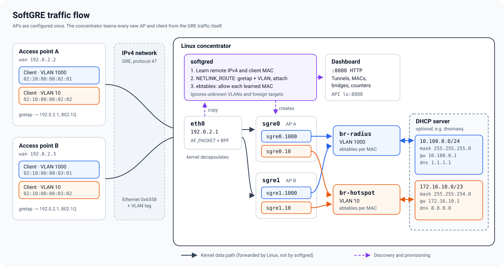

# SoftGRE

SoftGRE is a self-provisioning GRE Ethernet concentrator for Linux. Access points (or any
CPE) tunnel their subscribers' VLAN-tagged Ethernet frames over IPv4 GRE to one server.
You never configure a tunnel per AP: when traffic from a new AP arrives, `softgred`
creates its `gretap` and VLAN interfaces, attaches them to your Linux bridges and opens the
bridge firewall for each client MAC it sees. This is the "soft-GRE" model used for Wi-Fi
aggregation and hotspots, built from standard kernel parts.



## How it works

1. **The AP side is static.** Each AP has a `gretap` toward the concentrator's IPv4
   address and one 802.1Q VLAN per service (for example VLAN 1000 for a RADIUS-backed SSID
   and VLAN 10 for an open hotspot). Clients are bridged into those VLANs.
2. **Passive discovery.** `softgred` reads a copy of the GRE traffic on the capture
   interface with AF_PACKET and a kernel BPF filter. It accepts only GRE v0 carrying
   VLAN-tagged Ethernet (`0x6558`, [RFC 2784](docs/rfc2784.txt)) addressed to its own IPv4
   address, with a mapped VLAN.
3. **On-demand provisioning.** The first packet from a new remote creates `sgreN` for it
   through native NETLINK_ROUTE, plus one VLAN interface for *every* `bridge-map` entry,
   each attached to its bridge (`sgreN.1000 -> br-radius`, `sgreN.10 -> br-hotspot`).
4. **MAC learning and firewall.** Each new source MAC is bound to the remote it came from
   and gets an ebtables accept rule in the daemon's own `SOFTGRE_IN`/`SOFTGRE_OUT` chains.
   Other traffic on tunnel ports is dropped. Broadcast and multicast toward tunnels stay
   allowed, so ARP, DHCP and neighbor discovery work. Global firewall rules are untouched.
5. **The kernel forwards.** After provisioning, frames flow through `gretap`, VLANs and
   bridges entirely in the kernel. The daemon only handles discovery.
6. **Services sit behind the bridges.** Each bridge is a separate service network. Routing,
   NAT, and an optional DHCP server live there, so every VLAN can hand out its own subnet,
   mask, gateway and DNS (see [DHCP per bridge](#dhcp-per-bridge)).

A Python dashboard shows learned MACs, tunnel interfaces, bridge membership and packet
counters. `SIGUSR1` clears the learned state, and an event log records every tunnel,
VLAN attachment and client.

- [Complete English guide](docs/en_US/index.md)
- [Documentation website](https://jpereira.github.io/softgre/)
- [Debian/Ubuntu releases](https://github.com/jpereira/softgre/releases)
- [Container image](https://github.com/jpereira/softgre/pkgs/container/softgre)

## Run the release image

The amd64 production image is available as `ghcr.io/jpereira/softgre:2.0.1` and `:latest`.
Authenticate with `docker login ghcr.io` if the package visibility requires it.
Configure the capture interface and VLAN mappings in your local `softgred.conf`.
Run on Linux with the required kernel networking support:

```sh
docker pull ghcr.io/jpereira/softgre:2.0.1
docker run --rm --network host --cap-add NET_ADMIN --cap-add NET_RAW \
  -v /absolute/path/softgred.conf:/etc/softgred/softgred.conf:ro ghcr.io/jpereira/softgre:2.0.1
```

The daemon and dashboard start together. The dashboard listens on port 8080.
Host networking lets the daemon create interfaces on the Linux host.
Use the isolated Ubuntu lab below for experiments.

## Run the Ubuntu 24.04 lab

Use Docker on a Linux host. Replace `192.168.1.253` with the Docker host's main IPv4
address. The lab uses systemd, privileged mode and a private cgroup namespace. Its test
interfaces live inside the container's network namespace.

```sh
git clone https://github.com/jpereira/softgre.git
cd softgre
docker build -f docker/Dockerfile.lab -t softgre-lab:ubuntu24.04 .
docker run -d --name test-softgre --restart unless-stopped --privileged --cgroupns=private --tmpfs /run --tmpfs /run/lock -p 192.168.1.253:8080:8080 softgre-lab:ubuntu24.04
```

Choose an unused container name and port. Open `http://192.168.1.253:8080/index.html`.
The daemon and unprivileged Python backend start together. The initial state has capture
interface `sg-test-in` at `192.0.2.1/24`, injection peer `sg-test-peer`, and bridges
`br-radius` and `br-hotspot`. No remote tunnels are learned until packets arrive.

## Watch a complete provisioning flow

Send GRE Ethernet/VLAN frames from three synthetic clients:

```sh
docker exec test-softgre python3 /opt/softgre-lab/send.py
```

The script sends five packets for each client, waits for MAC learning and verifies
bridge attachment using the live HTTP API and kernel interface data. On a fresh lab,
the resulting topology is:

```text
Remote 192.0.2.2 -> sgre0
  MACs: 02:00:00:00:00:42, 02:00:00:00:00:43
  sgre0.1000 -> br-radius
  sgre0.10   -> br-hotspot

Remote 192.0.2.3 -> sgre1
  MAC: 02:00:00:00:00:44
  sgre1.1000 -> br-radius
  sgre1.10   -> br-hotspot
```

Each new remote receives every configured VLAN interface, not only the VLAN from its
first packet. Interface slot names depend on which names are free. Confirm the result:

```sh
docker exec test-softgre ip -d link show type gretap
docker exec test-softgre bridge link show
docker exec test-softgre brctl show
docker exec test-softgre /opt/softgre-lab/status.sh
```

The dashboard refreshes every five seconds and shows two tunnels, three learned MACs,
VLAN membership and RX/TX counters. Add another remote with a unique source MAC:

```sh
docker exec test-softgre python3 /opt/softgre-lab/send.py --remote 192.0.2.4 --mac 02:00:00:00:00:45 --vlan 10 --count 20
```

Follow the event log, which includes IPv4 addresses, created interfaces, bridges and MACs:

```sh
docker exec test-softgre tail -f /var/log/softgred.log
```

Example event messages, excluding their timestamp/PID/severity prefix:

```text
Tunnel created remote=192.0.2.2 local=192.0.2.1 interface=sgre0 ingress=sg-test-in
VLAN attached remote=192.0.2.2 interface=sgre0.1000 vlan=1000 bridge=br-radius
Client learned remote=192.0.2.2 mac=02:00:00:00:00:42 tunnel=sgre0 clients=1
```

Clear learned state with `SIGUSR1`, then inject again to watch reprovisioning:

```sh
docker exec test-softgre sh -c 'kill -USR1 "$(cat /run/softgre-lab/softgred.pid)"'
docker exec test-softgre python3 /opt/softgre-lab/send.py
```

This lab tests real GRE decoding, kernel provisioning and bridge attachment with
synthetic peers. It does not provide a separate remote router or a complete subscriber
LAN. Interface packet counters include all their traffic. Stop the persistent lab with
`docker stop test-softgre`.

## DHCP per bridge

SoftGRE has no DHCP server of its own. It delivers each VLAN to a bridge, and any DHCP
server on that bridge serves the clients behind every AP. One dnsmasq instance can give
each bridge a different network, mask, gateway and DNS. On the concentrator, give each
bridge a gateway address and add one range per bridge:

```sh
sudo ip addr add 10.100.0.1/24 dev br-radius
sudo ip addr add 172.16.10.1/23 dev br-hotspot
```

```ini
# /etc/dnsmasq.d/softgre.conf
port=0
bind-interfaces
interface=br-radius
interface=br-hotspot
dhcp-authoritative

dhcp-range=set:radius,10.100.0.100,10.100.0.199,255.255.255.0,1h
dhcp-option=tag:radius,option:router,10.100.0.1
dhcp-option=tag:radius,option:dns-server,1.1.1.1

dhcp-range=set:hotspot,172.16.10.100,172.16.11.199,255.255.254.0,1h
dhcp-option=tag:hotspot,option:router,172.16.10.1
dhcp-option=tag:hotspot,option:dns-server,8.8.8.8

# Record which AP (remote) and tunnel each lease came through.
dhcp-script=/usr/share/softgred/dhcp-lease-hook.py
```

`port=0` turns off dnsmasq's DNS service so it only does DHCP. Remove it to also run a
local resolver. A client on VLAN 1000 of any AP gets `10.100.0.x/24` with DNS `1.1.1.1`,
and a client on VLAN 10 gets `172.16.10.x/23` with DNS `8.8.8.8`. Add routing/NAT from
the bridges to your uplink as usual.

### Which AP is behind each lease

The DHCP server only sees the client MAC. `softgred` already knows which remote and
tunnel learned that MAC, so the lease hook asks the API (`GTMC <mac>`) on every lease
event and prints one line, which dnsmasq writes to its log:

```text
DHCP lease action=add ip=10.100.0.101 mac=02:10:00:00:02:01 interface=br-radius remote=192.0.2.2 tunnel=sgre0
```

The binding comes from the tunnel the client's traffic actually arrived on, so clients
cannot forge it. Because the API listens on loopback, run dnsmasq on the concentrator.
dnsmasq passes its environment to the hook: set `SOFTGRE_API_PORT` (and
`SOFTGRE_API_HOST`) when the API does not use `127.0.0.1:8888`, and `SOFTGRE_DHCP_LOG` to
also append the lines to a file, for example with a systemd drop-in for dnsmasq:

```ini
[Service]
Environment=SOFTGRE_DHCP_LOG=/var/log/softgred-dhcp.log
```

The hook never fails a lease. If the API is unreachable or the MAC is unknown, it logs
`remote=- tunnel=-`.

### End-to-end DHCP test

[`tests/dhcp_integration.py`](tests/dhcp_integration.py) builds this whole picture with
network namespaces: two real APs (`192.0.2.2`, `192.0.2.3`) with `gretap` and VLANs 1000
and 10, one client per VLAN behind each AP, and dnsmasq attached to `br-radius` and
`br-hotspot` with the configuration above. All four clients run `udhcpc` at the same
time, and their DHCP broadcasts teach `softgred` the tunnels and client MACs. The test
checks that:

- every client got the address range, mask, gateway and DNS of its own bridge;
- every client pings its gateway through the tunnel;
- the clients of AP A ping the clients of AP B on the same VLAN, through both tunnels
  and the learned-MAC firewall rules;
- the API reports the learned MACs and the bridge attachments;
- the lease hook logged the right AP and tunnel for each lease.

```sh
docker build -f docker/Dockerfile.test -t softgre-test .
docker run --rm --privileged -e SOFTGRE_TEST_NAMESPACE=isolated softgre-test \
  python3 tests/dhcp_integration.py /usr/sbin/softgred
```

```text
4 DHCP leases through 2 learned tunnels in 1.24s
sg-ap2-c1000: 02:10:00:00:02:01 via 192.0.2.2/sgre0.1000 -> br-radius ip=10.100.0.101 mask=255.255.255.0 dns=1.1.1.1
sg-ap2-c10: 02:10:00:00:02:02 via 192.0.2.2/sgre0.10 -> br-hotspot ip=172.16.11.142 mask=255.255.254.0 dns=8.8.8.8
sg-ap3-c1000: 02:10:00:00:03:01 via 192.0.2.3/sgre1.1000 -> br-radius ip=10.100.0.100 mask=255.255.255.0 dns=1.1.1.1
sg-ap3-c10: 02:10:00:00:03:02 via 192.0.2.3/sgre1.10 -> br-hotspot ip=172.16.10.137 mask=255.255.254.0 dns=8.8.8.8
[2026-10-14T16:39:15+0000] DHCP lease action=add ip=172.16.11.142 mac=02:10:00:00:02:02 interface=br-hotspot remote=192.0.2.2 tunnel=sgre0
...
DHCP integration: per-bridge networks, masks, gateways and DNS passed
```

`--privileged` is needed to create network namespaces. Every interface and namespace
lives inside the disposable container. CI runs this test on every push.

## Build and run on Linux

```sh
sudo apt-get install build-essential autoconf automake pkg-config libglib2.0-dev ebtables iptables iproute2 python3
./autogen.sh --prefix=/usr --sysconfdir=/etc --localstatedir=/var --with-piddir=/run
make -j2
make check
sudo make install
```

Edit `/etc/softgred/softgred.conf` for an interface with a local IPv4 address:

```ini
[global]
interface = eth0
tunnel-prefix = sgre
bridge-map = 1000@br-radius,10@br-hotspot
bridge-force = true
pid-file = /run/softgred.pid
log-file = /var/log/softgred.log

[service]
bind-in = lo
port = 8888
max-listen = 32
```

Start the daemon and its unprivileged dashboard together:

```sh
sudo python3 /usr/share/softgred/run-services.py
```

Open `http://SERVER_IP:8080/index.html`. The TCP API remains on loopback. Systemd starts
both services by default, and the production Docker image uses the supervisor. Python is a
package dependency; the dashboard is included by default in source builds. Use
`--disable-web` for a source build without the frontend. The dashboard has no
authentication; use a trusted management network or an access-controlled reverse proxy.

## Build a Debian or Ubuntu package

On Linux, install the build dependencies, configure the source and run:

```sh
sudo apt-get install build-essential autoconf automake pkg-config libglib2.0-dev debhelper
./autogen.sh
make deb
```

The target runs the Debian build and regression tests. Packages are written to the
parent directory as `softgred_VERSION_ARCH.deb`; it does not install on the host.
Every Debian Docker image builds a deb, installs it with apt and validates the installed
files. Runtime integration uses `/usr/sbin/softgred` and the packaged web backend.
Distribution-specific release builds also install and validate their package.

## Restart and inspect services

On a Linux host with systemd, install the units when using a source build. Package
builds install them automatically. Stop manually started daemon/backend processes before
switching to the service manager:

```sh
sudo install -m 644 share/softgred.service /etc/systemd/system/softgred.service
sudo install -m 644 share/softgred-web.service /etc/systemd/system/softgred-web.service
sudo systemctl daemon-reload
sudo systemctl enable --now softgred-web.service
sudo systemctl restart softgred.service
sudo systemctl status softgred.service softgred-web.service
sudo journalctl -u softgred -u softgred-web -f
```

The enabled companion starts with the daemon; daemon restarts propagate to the dashboard.
`service softgred restart` delegates to the service manager on supported Linux hosts.
`journalctl` reads the journal and does not start, stop or restart services.

The Ubuntu lab runs systemd as PID 1 and starts both installed package services:

```sh
docker exec test-softgre systemctl status softgred softgred-web
docker exec test-softgre service softgred restart
docker exec test-softgre journalctl -u softgred -u softgred-web -f
docker exec test-softgre tail -f /var/log/softgred.log
```

A daemon restart clears learned state. Run `/opt/softgre-lab/send.py` again to populate
both bridges and the dashboard. This disposable lab uses privileged mode with a private
cgroup namespace; it does not use host networking or mount the host cgroup tree.
Containers include `systemctl`, `journalctl`, `service`, `logrotate`, `brctl`, `ifconfig`,
`netstat`, `htop`, `vim`, `strace` and `lsof`.

## Protocol scope

Accepted traffic uses outer IPv4, unkeyed GRE v0 with zero flags, Ethernet protocol
`0x6558`, and one inner VLAN mapped to a configured bridge. The parser supports up to
two outer VLAN tags and IPv4 options. Outer IPv6, IP fragments, GRE keys/checksums,
untagged inner Ethernet and inner QinQ are unsupported. A MAC belongs to one remote;
learning does not provide authentication, automatic roaming or idle expiry.
## Relationship to Alcatel-Lucent/Nokia 7750 SR

SoftGRE implements packet-driven GRE discovery and Linux bridging. The corresponding
7750 SR feature is WLAN-GW soft-GRE. Nokia describes learning AP encapsulation without
configuring every AP endpoint. Its WLAN-GW design uses ISA/ESA resources; available
features depend on the platform and SR OS release. See the official
[Wi-Fi aggregation and offload guide](https://documentation.nokia.com/sr/26-3/7750-sr/books/tpsda/wi-fi-aggregation-offload.html).

| Area | 7750 SR WLAN-GW soft-GRE | This project |
| --- | --- | --- |
| Peer discovery | Learns AP encapsulation without a configured IP per AP. | Learns remote IPv4 and MACs from accepted packets. |
| Encapsulation | Ethernet and MPLS-over-GRE access variants. | IPv4, GRE v0, flags zero, Ethernet `0x6558`, one inner VLAN. |
| VLAN mapping | Inner VLAN selects a retail service context. | Static `VLAN@bridge` mappings create Linux VLAN interfaces. |
| Forwarding | WLAN-GW processing on ISA/ESA resources. | Native `gretap`, VLANs and bridges forward in the Linux kernel. |
| Subscriber management | ESM and RADIUS integration. | MAC permissions; no built-in RADIUS, DHCP server or subscriber billing. |
| Mobility | Inter-AP mobility anchoring. | A MAC stays with one remote until learned state is cleared. |
| QoS | Per-tunnel/per-SSID shaping. | No built-in bandwidth shaping. |
| Availability | WLAN-GW standby/redundancy functions. | One daemon; no state replication or automatic failover. |

The subscriber-management example is documented in Nokia's
[Basic Open SSID configuration guide](https://documentation.nokia.com/acg/25-3-2/books/tpsda-classic/c091-wifi-aggoffbasicssid.html).
For residential bridging, Nokia documents soft-GRE access in its
[Virtual Residential Gateway guide](https://documentation.nokia.com/sr/25-10/7750-sr/books/tpsda/virtual-residential-gateway-triple-play.html).
This project's service boundary is the Linux bridge; external routing, DHCP and subscriber
services must be designed separately. No interoperability or throughput comparison with
a physical 7750 SR has been measured. Matching the encapsulation subset alone does not
establish feature parity. Compile-time ceilings are 4096 tunnel slots, 1024 MACs per tunnel
and ten VLAN-to-bridge mappings; free interface names and host resources affect capacity.

## Validation

```sh
scripts/check-linux.sh
python3 tests/test_web.py
scripts/check-lab.sh
python3 scripts/build-docs.py
python3 tests/test_docs.py
```

The full compiler matrix needs GCC, Clang, sanitizer runtimes and Python. The CI covers
packet parsing, configuration, firewall ownership, signals, rollback, real GRE/VLAN
forwarding, log rotation, both web adapters, packages and the lab's restart lifecycle.

Licensed under LGPL-3.0-or-later; see [LICENSE.md](LICENSE.md).
